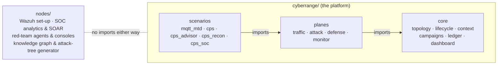

# Smart Grid AI-MTD

A **cyber range for smart-grid security**, emulated with
[Kathará](https://github.com/KatharaFramework/Kathara). It began as AI-driven
Moving Target Defense (MTD) for MQTT communications in a smart grid — still its
first scenario — and grew into a platform for testing attacks and defences on
emulated cyber-physical systems **safely, reproducibly and observably**.

Scenarios run as emulated labs of containers, attacks and defences are composed
from reusable *plane* components, and every run is seeded, scored and recorded.

## The scenarios

| Scenario | What it studies |
|---|---|
| [`mqtt-mtd`](scenario-mqtt.md) | Moving Target Defense against ML traffic fingerprinting of MQTT smart-grid traffic. |
| [`cps`](scenario-cps.md) | A cyber-physical OT/Modbus plant: an IT→OT attack, DPI and host sensors, and a SOC (Wazuh + analytics) that decides and responds inside the lab. |
| [`cps-advisor`](scenario-cps-advisor.md) | The `cps` lab with people in it: the SOC *advises* an operator instead of acting, and a [red team can play against a blue team](playground-red-vs-blue.md). |
| [`cps-recon`](scenario-cps-recon.md) | The `cps` lab with an attacker that is *not* handed the attack tree: it derives it by reconnaissance, and the run scores how close the derived tree is to the true one. |
| [`cps-soc`](scenario-cps-soc.md) | The `cps-advisor` lab with the tools of a real SOC for the blue team: Wazuh as SIEM and DFIR-IRIS as case management. |

New here? The [Overview](platform-overview.md) introduces the platform and the CPS
scenario in one read; [Set-up and first run](getting-started.md) gets one running.

## Architecture at a glance

The platform lives in one package, `cyberrange/`, laid out as three layers.
**Imports point one way** — `core ← planes ← scenarios` — and `nodes/` (the
software the lab's nodes run) imports none of them and is imported by none.

The four **planes** are the reusable building blocks a scenario composes:

- **traffic** — background trace replay, the nanogrid MQTT publishers, the plant and PLC;
- **attack** — the fingerprinting classifier, the attack chains, the in-lab tree-guided and recon-driven attackers, the red team's console;
- **defense** — the MTD coordinators (fixed-timer and RL), the OT/IT sensors, Wazuh, the SOC's analytics and the SOC's tools (Wazuh indexer and dashboard, DFIR-IRIS);
- **monitor** — capture, the telemetry/plant mirrors, the web terminals and the record of what people type in them.

Each plane exposes its components in `components.py`; one scenario directory holds
one scenario, whole — which is what makes `make platform-loc` a true measure of
what a new scenario costs. See [Architecture](platform.md) for the scenario
contract, [Components](components.md) for the catalogue, and
[Where files go](structure.md) for the layering rules.

## Where to go next

- **Run something**: [Set-up and first run](getting-started.md), then [Running and measuring](running-and-metrics.md) and [The dashboard](dashboard.md).
- **Understand a scenario**: the scenario pages above.
- **Play it**: the [red vs blue playground](playground-red-vs-blue.md) for people, [harnesses as players](playing-with-agents.md) for agents.
- **Understand the response loop**: [SOAR — KG & attack trees](kg-and-attack-trees.md).
- **Build on it**: [Extending the platform](extending.md), [Creating a scenario](new-scenario.md) and [Contributing](contributing.md).
- **Look something up**: [targets, variables and artifacts](reference.md), [Troubleshooting](troubleshooting.md), the [Glossary](glossary.md).
