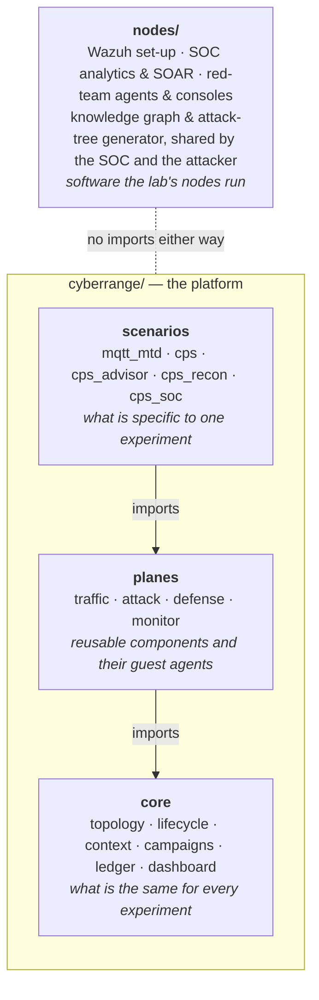
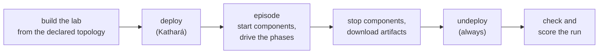
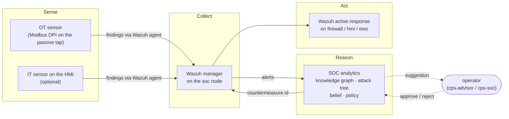

# The platform and the CPS scenario: an overview

This page introduces the cyber range to someone who has not worked on it yet.
The first part covers the platform: what it is for, how it is built and what
happens during a run. The second introduces the cyber-physical (`cps`)
scenario — the lab, the attack, the defence and what is measured — and points
to the pages that describe each in detail.

Each section ends with links to the reference pages that go deeper.

---

## Part 1 — The platform

### 1.1 What it is

A **cyber range for smart-grid security**. It builds small, realistic networks
of containers (with [Kathará](https://github.com/KatharaFramework/Kathara)),
runs attacks and defences against them, and scores the outcome. It is designed
around three properties:

| Property | What it means in practice |
|---|---|
| **Safe** | Every attack hits an emulated network and a digital twin of the plant, never real equipment. Each lab is an isolated set of containers, and the platform always tears it down at the end of a run, even when the run fails. |
| **Reproducible** | Every run is seeded, and each process derives its own seed from the run's seed. The network, the options and the software are declared, and dependencies and images are pinned. Running the same configuration with the same seed gives the same experiment. |
| **Observable** | Every run records what really happened, what the defenders saw, and a live timeline that a dashboard follows. Metrics are computed as soon as a run ends, and campaigns aggregate them with confidence intervals. |

It started as the testbed of a paper on AI-driven Moving Target Defense for
MQTT smart-grid traffic. That is still the `mqtt-mtd` scenario. The platform
has since grown to cover OT/Modbus attacks, a SOC that detects and responds,
and exercises with people on both sides.

### 1.2 The vocabulary

| Term | Meaning |
|---|---|
| **Lab** | A running set of containers wired into networks: the emulated environment. |
| **Scenario** | One experiment: its network, the software that runs on each node, the sequence of phases (the *episode*) and its metrics. |
| **Run** | One execution of a scenario with one configuration and one seed. |
| **Campaign** | Many runs (configurations × seeds), executed one after another, resumable, aggregated at the end. |
| **Plane** | A family of reusable building blocks: *traffic*, *attack*, *defense*, *monitor*. |
| **Component** | One building block of a plane: something that starts on a node, runs, and produces logs and telemetry (e.g. the DPI sensor, the PLC, the attacker). |
| **Guest agent** | The program a component actually runs inside a container. |
| **Node software** | The software of a node that is not the platform's own: tool configuration (Wazuh rules), the SOC's analytics, the red team's console. It lives in `nodes/`. |

### 1.3 How it is built

The code is one package, `cyberrange/`, in three layers, plus `nodes/`:



Two rules hold the design together:

- **Imports point one way: `core ← planes ← scenarios`.** A plane never knows
  which scenario uses it. Anything scenario-specific is passed in as an
  argument (for example, the attacker receives its attack tree as data). This
  keeps components reusable, and it lets `make platform-loc` measure exactly
  how much code a new scenario costs.
- **What runs inside the lab is isolated from what runs on the host.** Guest
  agents and node software use only the standard library and what the node's
  image installs. They never import the platform: they run in containers where
  the repository does not exist. The platform deploys, observes and scores,
  while the nodes decide and act.

Both rules are enforced by tests (`tests/core/`).

### 1.4 What happens during a run



1. The scenario **declares** its network as plain data: nodes, interfaces,
   addresses, routes and the files staged on each node. The platform turns it
   into a Kathará lab, and writes it as `topology.json` in the run directory.
2. The lab is **deployed**.
3. The **episode** runs. It starts the components (plant, PLC, sensors, SOC,
   attacker…) and moves through named phases, such as `services`, `normal`,
   `attack` and `post_attack`. Each phase has a planned duration, which gives
   the dashboard its ETA.
4. The platform **stops** the components and **downloads** their artifacts:
   logs, captures, telemetry.
5. The lab is **undeployed**. This happens even if the episode crashed or was
   interrupted with Ctrl-C.
6. The scenario **checks** the run and computes its **metrics**
   (`metrics.json`).

With `--playground` (or `PLAYGROUND=1`), a run keeps its lab up after the
episode until Ctrl-C, so that people can work in it by hand.

### 1.5 Three records per run, kept apart on purpose

| File | Written by | Contents | Who may read it |
|---|---|---|---|
| `ground_truth.jsonl` | the host only | what really happened: every attack step and write with its timestamp, every block, every fault | scorers. **Never a defender.** |
| `<node>.telemetry.jsonl` | the defence, inside the lab | what the defenders observed and did: findings, alerts, decisions, actions | detectors, the SOC, metrics |
| `progress.jsonl` | the host's ledger | the run as it unfolds: phases, live plant state, a mirror of the telemetry, the attacker's steps | the dashboard |

A defender is always scored against information it could not have had. This
separation is what makes detection and response metrics trustworthy.

### 1.6 Campaigns and metrics

A **campaign** is a grid of runs (for example 7 attack modes × 10 seeds). It
runs them one at a time on a single ledger. It **resumes** where it stopped:
runs that already have their `metrics.json` are skipped, and a failed run is
retried once. After each run the aggregate is refreshed: n, mean, standard
deviation, 95% confidence interval, median, min and max of every metric, per
configuration (`summary.md`, `ci.csv`).

### 1.7 The dashboard

`make dashboard` serves a local page (http://127.0.0.1:8765) that follows every
run and campaign under `output/`, live or after the fact. It **only reads**:
nothing on the page can change the lab or the files on disk.

Every scenario gets the common parts of the page: the runs to choose from in a
column on the left, the views as tabs in the middle (the run, and the campaign
with its progress, ETA and results with confidence intervals), and a time bar,
always in sight, to replay a run at ×1/×5/×20. Each scenario adds its own panel
on top;
[The dashboard](dashboard.md) describes them all.

The page is written for a reader who has not seen the code: attack steps,
countermeasures and metrics go by their names (the recorded identifier is on
hover), figures carry their unit, a relative time says what it is counted from,
and an empty table says why it is empty. The badge next to the title tells
whether the page is still hearing from its server. Its charts, columns and long
lists are drawn with libraries (Observable Plot, D3, Split.js, Tabulator) served
from the repository itself, so it works on a machine with no internet access.

### 1.8 The scenarios

| Scenario | Question it answers |
|---|---|
| `mqtt-mtd` | Can Moving Target Defense hide MQTT smart-grid traffic from an ML fingerprinting attacker, and at what cost? |
| `cps` | Can a defence detect, and respond to, an IT→OT attack on an electrical plant, ideally before the physical effect? |
| `cps-advisor` | The same lab, with a person in the loop: the SOC suggests countermeasures and an operator approves them. With `--teams`, a red team plays against a blue team. |
| `cps-recon` | The same lab, with an attacker that is not given the attack tree and must derive it by reconnaissance. |
| `cps-soc` | The `cps-advisor` lab, with the tools of a real SOC for the blue team: Wazuh SIEM and DFIR-IRIS case management. |

The last three are built on `cps`. They deploy the same lab under their own
name, so they can run side by side, and each one is `cps` with one or two
**features** — `People` (an operator, teams), `SocTools` (Wazuh and IRIS),
`Recon` (an attacker that finds its own way) — composed rather than inherited:
a new combination is a tuple, not a new class.

### 1.9 Technology

| Need | Tool |
|---|---|
| Network emulation | Kathará (Docker containers, one per node; one collision domain per network) |
| Power-system physics | pandapower (a real power-flow computation) |
| Industrial protocol | Modbus/TCP (pymodbus on the plant and PLC; parsed by hand in the sensor) |
| Security monitoring | Wazuh (manager, agents, active response); Wazuh indexer and dashboard in `cps-soc` |
| Case management | DFIR-IRIS (`cps-soc`) |
| Knowledge graph and reasoning | networkx, on the SOC node |
| Reconnaissance | nmap, plus living-off-the-land on the compromised host (`cps-recon`) |
| Shells for people | ttyd (web terminal), SSH from the SOC as a jump host |
| Documentation | MkDocs Material (`make docs-serve`) |

Further reading: [Architecture](platform.md) · [Where files go](structure.md) ·
[Components](components.md) · [Running and measuring](running-and-metrics.md).

---

## Part 2 — The CPS scenario

This part is the scenario in brief: enough to follow a run. Each paragraph
names the page that has the detail.

### 2.1 The story

A small low-voltage electricity-distribution plant is run by a PLC and supervised
by an operator from an HMI on the office network. An attacker starts on the office
(IT) network. It wants to cause a **physical effect** on the plant: an
overvoltage, a line overload, or a section of the grid left without power.

```
 IT intrusion ──▶ pivot into OT ──▶ malicious Modbus command ──▶ physical effect
      │                 │                     │                        │
      └──── each step can be detected, and answered, by the defence ───┘
```

The defence has a passive network sensor on the plant's network, an optional
host sensor on the HMI, and a SOC running Wazuh plus an analytics service. The
SOC builds a model of the network and of the possible attacks, keeps a belief
about where the attack currently is, and chooses countermeasures. It can act
automatically, or advise a person who decides.

The scenario's central question is: **can the defence recognise the attack, and
stop it, before the plant suffers?** When it cannot, the scenario measures how
much the plant suffers.

### 2.2 The lab, the plant and the attack

**The lab** has three networks — IT, OT and management — and eight nodes. The
attacker and the operator's HMI are on IT; the PLC and the plant's engine are
on OT; a firewall between them lets one flow through, from the HMI to the
engine over Modbus; an engineering workstation stands on both. The sensor and
the SOC are on the management network. The topology, the addresses and the two
channels that must not be confused are in
[CPS §2](scenario-cps.md#2-architecture).

**The plant** is a small low-voltage feeder simulated with pandapower: a real
power-flow computation behind a Modbus/TCP server. A PLC keeps the voltage in
band; the operator can take manual authority from the HMI
([CPS §3](scenario-cps.md#3-the-physical-process)).

**The attack** has to go through a legitimate host. The attacker exploits a
vulnerable web application on the HMI and writes to the plant from there, or
takes the engineering workstation and falsifies what the PLC reads. Seven
attack modes differ in how loud and how lasting their effect is
([CPS §5](scenario-cps.md#5-the-attack-modes)). The steps an attacker can
take are an **attack tree**, generated from a knowledge graph of the lab; an
attacker can follow a fixed chain, plan on the tree step by step, or — in
`cps-recon` — derive the tree itself by reconnaissance
([KG and attack trees](kg-and-attack-trees.md)).

### 2.3 The defence

The defence is a chain: **sense → collect → reason → act**, with an optional
person between reasoning and acting. All of it runs **inside the lab**. The host
only starts it, watches it and scores it.



The sensors and their rules are in [CPS §6](scenario-cps.md#6-detection). How
the SOC maps alerts onto the tree, keeps its belief and picks countermeasures —
and the countermeasures themselves — are in
[KG and attack trees](kg-and-attack-trees.md). In `cps` the SOC acts by itself;
in `cps-advisor` every countermeasure is a suggestion an operator approves or
rejects, and one nobody answers expires: no answer is not consent. In `cps-soc`
the suggestions arrive as tasks in DFIR-IRIS.

### 2.4 A run and its score

An episode deploys the lab, starts its services, lets the plant run normally
while the sensor's behavioural model calibrates, runs the attack while the SOC
decides and acts, watches the plant afterwards, then collects the artifacts and
tears the lab down: about a minute and a half
([CPS §7](scenario-cps.md#7-running-an-experiment)).

The score is computed afterwards, from the artifacts: whether and how fast each
detector saw the attack, and whether **before the physical impact**; how much
the plant suffered and whether it recovered; whether the response was the one
the attack called for, how fast, and at what cost to the operator
([CPS §9](scenario-cps.md#9-what-is-measured)). [The dashboard](dashboard.md)
follows the run while it happens and replays it afterwards.

### 2.5 Variants and playgrounds

| Want to… | Use |
|---|---|
| measure detection and automatic response | `cps` (`make cps-attack`, `make cps-campaign`) |
| put an operator between the SOC and the plant | `cps-advisor` (`make cps-advisor`) |
| run an exercise, red team vs blue team, with a referee | `make cps-teams` (or `make cps-soc-teams` with Wazuh + IRIS); guide in [Red vs blue playground](playground-red-vs-blue.md) |
| test an attacker that has to discover the target | `cps-recon` (`make cps-recon`) |
| give the blue team real SOC tools | `cps-soc` (`make cps-soc`); needs about 3 GB of extra memory |
| poke at the lab by hand | any target with `PLAYGROUND=1` |

In the team exercises, each team works from a console served by its **own
node**: the blue team from the SOC, the red team from the attacker node. Each
console is protected by a per-run token, and each team also has a web terminal.
Every command typed in those terminals goes on the record with the team it
belongs to. The referee watches the read-only dashboard.

### 2.6 Trying it and its limits

[Set-up and first run](getting-started.md) takes you to a first scored run.
What the scenario does not do yet is listed in
[CPS §11](scenario-cps.md#11-scope-and-what-is-next), and for the tree and the
response in [KG and attack trees §10](kg-and-attack-trees.md).

---

## Where to read more

| Topic | Page |
|---|---|
| Set-up and first run | [getting-started.md](getting-started.md) |
| The scenario contract, the run lifecycle, campaigns, the dashboard | [platform.md](platform.md) |
| Every component, with its options and artifacts | [components.md](components.md) |
| The CPS scenario, reference | [scenario-cps.md](scenario-cps.md) |
| Knowledge graph, attack tree, belief and policies in depth | [kg-and-attack-trees.md](kg-and-attack-trees.md) |
| People in the loop / SOC tools / recon attacker | [scenario-cps-advisor.md](scenario-cps-advisor.md) · [scenario-cps-soc.md](scenario-cps-soc.md) · [scenario-cps-recon.md](scenario-cps-recon.md) |
| The exercise, for those playing it | [playground-red-vs-blue.md](playground-red-vs-blue.md) |
| Terms | [glossary.md](glossary.md) |
