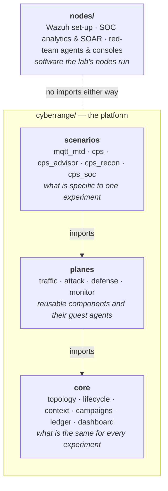
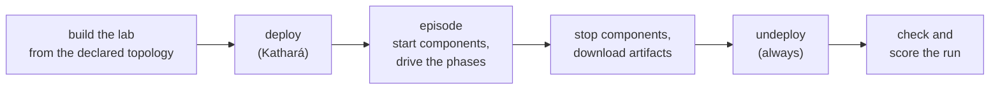
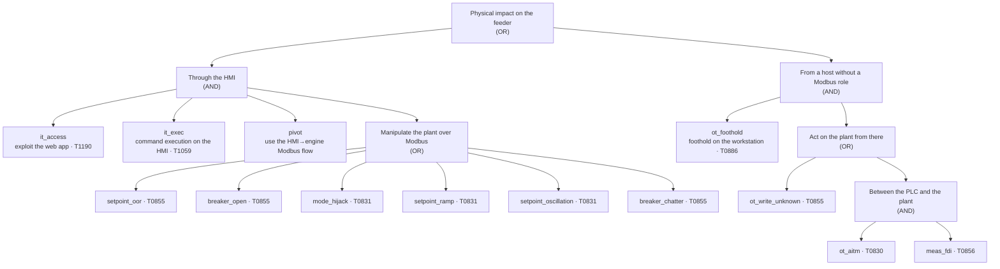

# The platform and the CPS scenario: an overview

This page introduces the cyber range to someone who has not worked on it yet.
The first half covers the platform: what it is for, how it is built and what
happens during a run. The second half covers the cyber-physical (`cps`)
scenario in detail: the network, the plant, the attack, the defence and what is
measured.

Each section ends with links to the reference pages that go deeper.

---

## Part 1 — The platform

### 1.1 What it is

A **cyber range for smart-grid security**. It builds small, realistic networks
of containers (with [Kathará](https://github.com/KatharaFramework/Kathara)),
runs attacks and defences against them, and scores the outcome. It is designed
around three properties:

| Property | What it means in practice |
|---|---|
| **Safe** | Every attack hits an emulated network and a digital twin of the plant, never real equipment. Each lab is an isolated set of containers, and the platform always tears it down at the end of a run, even when the run fails. |
| **Reproducible** | Every run is seeded, and each process derives its own seed from the run's seed. The network, the options and the software are declared, and dependencies and images are pinned. Running the same configuration with the same seed gives the same experiment. |
| **Observable** | Every run records what really happened, what the defenders saw, and a live timeline that a dashboard follows. Metrics are computed as soon as a run ends, and campaigns aggregate them with confidence intervals. |

It started as the testbed of a paper on AI-driven Moving Target Defense for
MQTT smart-grid traffic. That is still the `mqtt-mtd` scenario. The platform
has since grown to cover OT/Modbus attacks, a SOC that detects and responds,
and exercises with people on both sides.

### 1.2 The vocabulary

| Term | Meaning |
|---|---|
| **Lab** | A running set of containers wired into networks: the emulated environment. |
| **Scenario** | One experiment: its network, the software that runs on each node, the sequence of phases (the *episode*) and its metrics. |
| **Run** | One execution of a scenario with one configuration and one seed. |
| **Campaign** | Many runs (configurations × seeds), executed one after another, resumable, aggregated at the end. |
| **Plane** | A family of reusable building blocks: *traffic*, *attack*, *defense*, *monitor*. |
| **Component** | One building block of a plane: something that starts on a node, runs, and produces logs and telemetry (e.g. the DPI sensor, the PLC, the attacker). |
| **Guest agent** | The program a component actually runs inside a container. |
| **Node software** | The software of a node that is not the platform's own: tool configuration (Wazuh rules), the SOC's analytics, the red team's console. It lives in `nodes/`. |

### 1.3 How it is built

The code is one package, `cyberrange/`, in three layers, plus `nodes/`:



Two rules hold the design together:

- **Imports point one way: `core ← planes ← scenarios`.** A plane never knows
  which scenario uses it. Anything scenario-specific is passed in as an
  argument (for example, the attacker receives its attack tree as data). This
  keeps components reusable, and it lets `make platform-loc` measure exactly
  how much code a new scenario costs.
- **What runs inside the lab is isolated from what runs on the host.** Guest
  agents and node software use only the standard library and what the node's
  image installs. They never import the platform: they run in containers where
  the repository does not exist. The platform deploys, observes and scores,
  while the nodes decide and act.

Both rules are enforced by tests (`tests/core/`).

### 1.4 What happens during a run



1. The scenario **declares** its network as plain data: nodes, interfaces,
   addresses, routes and the files staged on each node. The platform turns it
   into a Kathará lab, and writes it as `topology.json` in the run directory.
2. The lab is **deployed**.
3. The **episode** runs. It starts the components (plant, PLC, sensors, SOC,
   attacker…) and moves through named phases, such as `services`, `normal`,
   `attack` and `post_attack`. Each phase has a planned duration, which gives
   the dashboard its ETA.
4. The platform **stops** the components and **downloads** their artifacts:
   logs, captures, telemetry.
5. The lab is **undeployed**. This happens even if the episode crashed or was
   interrupted with Ctrl-C.
6. The scenario **checks** the run and computes its **metrics**
   (`metrics.json`).

With `--playground` (or `PLAYGROUND=1`), a run keeps its lab up after the
episode until Ctrl-C, so that people can work in it by hand.

### 1.5 Three records per run, kept apart on purpose

| File | Written by | Contents | Who may read it |
|---|---|---|---|
| `ground_truth.jsonl` | the host only | what really happened: every attack step and write with its timestamp, every block, every fault | scorers. **Never a defender.** |
| `<node>.telemetry.jsonl` | the defence, inside the lab | what the defenders observed and did: findings, alerts, decisions, actions | detectors, the SOC, metrics |
| `progress.jsonl` | the host's ledger | the run as it unfolds: phases, live plant state, a mirror of the telemetry, the attacker's steps | the dashboard |

A defender is always scored against information it could not have had. This
separation is what makes detection and response metrics trustworthy.

### 1.6 Campaigns and metrics

A **campaign** is a grid of runs (for example 7 attack modes × 10 seeds). It
runs them one at a time on a single ledger. It **resumes** where it stopped:
runs that already have their `metrics.json` are skipped, and a failed run is
retried once. After each run the aggregate is refreshed: n, mean, standard
deviation, 95% confidence interval, median, min and max of every metric, per
configuration (`summary.md`, `ci.csv`).

### 1.7 The dashboard

`make dashboard` serves a local page (http://127.0.0.1:8765) that follows every
run and campaign under `output/`, live or after the fact. It **only reads**:
nothing on the page can change the lab or the files on disk.

Every scenario gets the common parts of the page: the campaign queue and ETA,
the phases of the current run, a time bar to replay a run at ×1/×5/×20, and the
results with confidence intervals. Each scenario adds its own panel on top. The
CPS panel is described in [§2.9](#29-following-a-run).

### 1.8 The scenarios today

| Scenario | Question it answers |
|---|---|
| `mqtt-mtd` | Can Moving Target Defense hide MQTT smart-grid traffic from an ML fingerprinting attacker, and at what cost? |
| `cps` | Can a defence detect, and respond to, an IT→OT attack on an electrical plant, ideally before the physical effect? |
| `cps-advisor` | The same lab, with a person in the loop: the SOC suggests countermeasures and an operator approves them. With `--teams`, a red team plays against a blue team. |
| `cps-recon` | The same lab, with an attacker that is not given the attack tree and must derive it by reconnaissance. |
| `cps-soc` | The `cps-advisor` lab, with the tools of a real SOC for the blue team: Wazuh SIEM and DFIR-IRIS case management. |

The last three are built on `cps`. They deploy the same lab under their own
name, so they can run side by side, and each one only adds what it needs on top
of it.

### 1.9 Technology

| Need | Tool |
|---|---|
| Network emulation | Kathará (Docker containers, one per node; one collision domain per network) |
| Power-system physics | pandapower (a real power-flow computation) |
| Industrial protocol | Modbus/TCP (pymodbus on the plant and PLC; parsed by hand in the sensor) |
| Security monitoring | Wazuh (manager, agents, active response); Wazuh indexer and dashboard in `cps-soc` |
| Case management | DFIR-IRIS (`cps-soc`) |
| Knowledge graph and reasoning | networkx, on the SOC node |
| Reconnaissance | nmap, plus living-off-the-land on the compromised host (`cps-recon`) |
| Shells for people | ttyd (web terminal), SSH from the SOC as a jump host |
| Documentation | MkDocs Material (`make docs-serve`) |

Further reading: [Architecture](platform.md) · [Where files go](structure.md) ·
[Components](components.md) · [Running and measuring](running-and-metrics.md).

---

## Part 2 — The CPS scenario

### 2.1 The story

A small low-voltage electricity-distribution plant is run by a PLC and supervised
by an operator from an HMI on the office network. An attacker starts on the office
(IT) network. It wants to cause a **physical effect** on the plant: an
overvoltage, a line overload, or a section of the grid left without power.

```
 IT intrusion ──▶ pivot into OT ──▶ malicious Modbus command ──▶ physical effect
      │                 │                     │                        │
      └──── each step can be detected, and answered, by the defence ───┘
```

The defence has a passive network sensor on the plant's network, an optional
host sensor on the HMI, and a SOC running Wazuh plus an analytics service. The
SOC builds a model of the network and of the possible attacks, keeps a belief
about where the attack currently is, and chooses countermeasures. It can act
automatically, or advise a person who decides.

The scenario's central question is: **can the defence recognise the attack, and
stop it, before the plant suffers?** When it cannot, the scenario measures how
much the plant suffers.

### 2.2 The network

Three networks (Kathará collision domains) and eight nodes:

```
        IT ZONE                  FIREWALL                OT ZONE
     10.10.0.0/24             10.10.0.1 |            10.20.0.0/24
  ┌──────────────────┐        10.20.0.1       ┌──────────────────────┐
  │ attacker  .0.10  │     ┌─────────────┐    │ plc        10.20.0.10│
  │ hmi       .0.20  │────▶│ FORWARD:    │───▶│ engine     10.20.0.20│
  │  (+ vulnerable   │     │ DROP except │    │  (digital twin +     │
  │   diagnostics)   │     │ HMI→engine  │    │   Modbus server)     │
  │ ews       .0.30 ─┼─────┼─────────────┼────┼─ ews       10.20.0.30│
  └────────┬─────────┘     │ Modbus/TCP  │    └──────────┬───────────┘
           │ eth1          └──────┬──────┘               │ passive tap
           │ 10.30.0.30           │ eth2 10.30.0.1       ▼ sensor eth1 10.30.0.10
  ─────────┴──────────────────────┴──────────────────────┴──────────────
        MGMT 10.30.0.0/24          soc 10.30.0.20      ews eth2 10.30.0.50
```

| Node | Role | IT 10.10.0.0/24 | OT 10.20.0.0/24 | MGMT 10.30.0.0/24 | What it runs |
|---|---|---|---|---|---|
| `attacker` | the adversary's box | .10 | — | — | the attack driver (scripted chain, tree-guided planner, or a red team's console) |
| `hmi` | operator workstation | .20 | — | .30 | the legitimate SCADA client; a **vulnerable diagnostics web app** (tcp/8080); a Wazuh agent; optionally the IT sensor |
| `ews` | engineering workstation | .30 | .30 | .50 | a remote-maintenance service (tcp/8081) whose credential sits in a config file on the HMI; a Wazuh agent |
| `firewall` | IT/OT boundary | .1 | .1 | .1 | iptables boundary; a Wazuh agent that enforces countermeasures |
| `plc` | controller | — | .10 | — | the PLC control loop (Modbus master) |
| `engine` | the plant | — | .20 | — | pandapower digital twin behind a Modbus/TCP server (tcp/5020) |
| `sensor` | network IDS | — | passive, no address | .10 | the Modbus DPI sensor (rules + behavioural model); a Wazuh agent |
| `soc` | security operations | — | — | .20 | Wazuh manager + the SOC analytics (knowledge graph, attack tree, policy) |

**The zones:**

- **IT** is the office network. The attacker lives here, next to the HMI.
- **OT** is the plant network: the PLC and the engine. The sensor listens here
  through an interface with no address, so it sees all the Modbus traffic, never
  transmits, and cannot be reached from OT.
- **MGMT** is the network of the security tooling. Agents report to the SOC over
  it, and countermeasures reach their host over it. The firewall forwards
  nothing to or from MGMT. The engine and the PLC are deliberately not on it:
  a host that shared a network with the engine could write to it without
  crossing the boundary.

**The firewall** drops all forwarded traffic except one sanctioned flow:
**HMI → engine, Modbus tcp/5020** (plus the replies to it). This rule has two
consequences:

1. The attacker cannot reach the plant directly. It has to compromise the HMI
   first and use it as a springboard.
2. The firewall cannot distinguish a legitimate operator command from a hijacked
   one, because both are "HMI to engine, tcp/5020". Compensating for that is
   the job of the DPI sensor and of the SOC.

**The two weak points are deliberate.** The HMI and the engineering workstation
both stand on IT and on MGMT, so whoever takes either one is on the management
network too. The workstation also stands on OT, like the machine that programs a
PLC in a real plant. It forwards nothing and speaks no Modbus of its own, but
whoever takes it is on the OT link, next to the PLC and the engine.

**The management network and instrumentation are separate channels.** The
experiment itself (ledger, dashboard, artifact download, ground truth) never
travels on a lab network. It goes through the container runtime (`docker exec`,
file copy), so no node in the lab can see it or reach it.

The lab is declared as data in `cyberrange/scenarios/cps/lab.py`: zones, hosts
with their roles and interfaces, services, and the flows the boundary allows.
Addresses, routes, the firewall ruleset, the list of hosts that run a Wazuh
agent and the SOC's inventory are all **derived** from it. A different lab is a
different specification, not new code. `make lab-conf SCENARIO=cps` exports the
lab as a classic Kathará `lab.conf` with its `.startup` files.

### 2.3 The physical plant

The plant is a low-voltage (0.4 kV) distribution feeder modelled in
**pandapower**. Voltages and loadings come from a power-flow computation that
runs every second; nothing is scripted.

```
external grid ──feeder line (breaker)── load bus ──line── generator bus
   (slack)                               (~50 kW)          (DG, 60 kW rated)
```

- A **load** of about 50 kW, with a seeded random variation.
- A **distributed generator (DG)** rated 60 kW, delivering about 20 kW in normal
  operation.
- **Normal state**: bus voltages within 0.95–1.05 pu, and line loading at or
  below 100%.

The plant is commanded through three **holding registers** on the engine, and
reports its state through **input registers**:

| Register | Name | Meaning | Who may write it |
|---|---|---|---|
| HR 0 | `dg_setpoint` | DG power setpoint (kW × 10; nominal 200 = 20 kW, maximum 600 = 60 kW) | PLC, HMI |
| HR 1 | `switch_cmd` | feeder breaker: 0 = closed, 1 = open | nobody remotely (only the SOC's responder) |
| HR 2 | `ctrl_mode` | control authority: 0 = AUTO (the PLC regulates), 1 = MANUAL (the operator) | HMI |
| IR 0–5 | measurements | load-bus voltage, DG-bus voltage, line loading, load power, DG power, "abnormal" flag | read-only |

All the nodes share this map, with its scales, the valid ranges and the per-role
access policy, through a single **plant contract**
(`cyberrange/planes/defense/ot_registers.py`). The PLC, the engine, the sensor
and the SOC's knowledge graph all read the same definition.

**A command can be legal and still dangerous.** The feeder is sized so that the
DG at 100% of its rating, a perfectly valid value, causes an overvoltage. That is
what makes the scenario interesting: a range check alone cannot stop an attacker
who sends in-range values from a legitimate host.

### 2.4 Normal operation

The plant never sits idle. The defence has to tell the attack apart from
legitimate traffic:

- **The PLC** (`plc_controller.py`) is the only automatic regulator. In AUTO it
  keeps the worst bus voltage in band, rejects setpoints outside the envelope,
  and relaxes back to the 20 kW nominal. In MANUAL it steps aside and leaves
  authority to the operator.
- **The HMI client** (`hmi_client.py`) keeps one persistent Modbus session that
  polls the plant. About every 12 s it performs a safe operator dispatch:
  MANUAL, 15–35 kW for 5 s, then back to AUTO. This is the legitimate behaviour
  the attack must be distinguished from.
- With the IT sensor enabled, the HMI also generates legitimate periodic traffic
  to its own diagnostics app, so that the IT sensor has a baseline too.

### 2.5 The attack

#### The way in

Every attack starts the same way:

1. **Initial access** (ATT&CK T1190). The attacker exploits a real OS command
   injection in the HMI's diagnostics web app (`vuln_app.py`).
2. **Execution** (T1059). It now runs commands on the HMI.
3. From there it takes one of **two paths** to the plant:
   - **Through the HMI** — the sanctioned flow. The HMI is allowed to talk Modbus
     to the engine, so the attacker's writes cross the firewall *from a legitimate
     host*.
   - **Through the engineering workstation** (T0886). From the HMI, the attacker
     reads the workstation's maintenance credential, takes the workstation, and is
     now directly on the OT link without crossing the firewall.

#### The attack tree

The SOC and the tree-guided attacker reason on the same attack tree. It is
built from the knowledge graph of the lab, so every precondition is checked
against the real network: if the firewall rule is removed, the "through the
HMI" branch becomes infeasible.



The IT steps (`it_access`, `it_exec`, `pivot`) are **not observable** by the OT
sensor. The SOC *infers* them once it observes a later OT step, unless the IT
sensor is running, in which case it *observes* them directly.

#### The attack modes

The scripted driver runs a fixed chain chosen with `CPS_ATTACK_MODE`:

| Mode | What the attacker does | Physical effect | How hard to detect |
|---|---|---|---|
| `setpoint-overvoltage` | writes a DG setpoint far outside the envelope (200 kW) | overvoltage and line overload; the PLC rejects the value and the plant recovers | low: plainly out of range |
| `breaker-open` | opens the feeder breaker | the downstream section loses power, and stays without it | low: nobody may write the breaker |
| `manual-hijack` | takes MANUAL authority, dispatches 60 kW (in range) | persistent overvoltage that outlives the attacker, because the PLC has stood down | **high**: every value is legal and the source is the HMI |
| `slow-ramp` | MANUAL, then raises the setpoint 1 kW at a time up to 60 kW | the same overvoltage, reached gradually | **high**: no single write is a jump |
| `setpoint-oscillation` | MANUAL, then swings the setpoint between 55 and 5 kW | the voltage swings for as long as the attacker writes | medium |
| `breaker-chatter` | opens and re-closes the breaker repeatedly, ending open | repeated loss of supply | low |
| `meas-fdi` | takes the workstation, ARP-poisons the PLC↔engine link, and reports every voltage to the PLC as 0.96 pu | the PLC believes the voltage is low and **overvolts the feeder by itself** | **no attacker write at all**: only address and reading anomalies give it away |

#### Who drives the attack

The same lab can be attacked by four kinds of driver:

| Driver | Where it runs | What it knows | Enabled by |
|---|---|---|---|
| **Scripted chain** | host-driven, through the attacker node | a fixed sequence per mode | default (`CPS_ATTACK_DRIVER=scripted`) |
| **Tree-guided planner** | in the lab, on the attacker node (`nodes/redteam/red_agent.py`) | it is handed the attack tree; it picks its next step from the current state and, if a countermeasure closes a path, tries another or gives up | `CPS_ATTACK_DRIVER=planner`, with a profile: `opportunistic` (biggest reachable impact), `targeted` (a chosen goal), `stealthy` (quietest impact, longer pauses); `CPS_DWELL` sets the pause between steps |
| **Recon-driven attacker** | in the lab, on its own image with nmap | only a scan scope; it **derives** its attack tree with nmap on IT and by living off the land on the HMI (reading `/proc/net/tcp`, using the HMI's own pymodbus) | the `cps-recon` scenario |
| **Human red team** | a web console and a terminal on the attacker node | only what its own steps reported | `cps-advisor` / `cps-soc` with teams |

All drivers compose the **same lab primitives** (the exploit client and the raw
Modbus writer), so they differ in strategy, not in capability. Every attack step
and every write is recorded with its timestamp in the ground truth.

### 2.6 The defence

The defence is a chain: **sense → collect → reason → act**, with an optional
person between reasoning and acting. All of it runs **inside the lab**. The host
only starts it, watches it and scores it.


#### Sense: the sensors

**The OT sensor** (`ot_sensor.py`, `ot_model.py`) sits on the passive tap. It
decodes Ethernet/IP/TCP/Modbus by hand, using only the standard library and
numpy, and pairs every request with its response. That way it knows both the
commands issued and the plant state they produced. Two detectors run in
parallel:

- **Rules**: out-of-range command; unknown client; role-policy violation (e.g.
  any write to the breaker); *unsafe command* (a sensitive write followed by the
  voltage leaving the band); *manual-mode excursion*; *address spoofing* (an IP
  seen from a different MAC, which points at a man-in-the-middle); *conflicting
  reading* (two different answers to the same request, which points at
  falsified measurements).
- **Behavioural model**: per-second features (session turnover, setpoint jump
  size, time in MANUAL, voltages) scored with a robust median/MAD model. The
  model calibrates on the first 45 s of normal operation, and it re-scores the
  current window on every write. That is what lets it flag an attack **before**
  the physical effect appears.

**The IT sensor** (`it_sensor.py`, enabled with `CPS_IT=1`) runs on the HMI and
makes the early steps observable:

| Evidence | Finding | Attack step |
|---|---|---|
| the diagnostics app's access log | `web_injection_pattern` | `it_access` |
| the process table (a child of the web app) | `web_child_process` | `it_exec` |
| open connections (a new Modbus client) | `unexpected_modbus_client` | `pivot` |

#### Collect: Wazuh

The SOC node runs the **Wazuh manager**. The sensor, the HMI, the workstation
and the firewall each run a **Wazuh agent**. These are the hosts on the
management network; the engine and the PLC run none. Findings travel as Wazuh
events and become alerts on the manager, with a median latency of about 0.5 s.
Countermeasures travel back the same way, as Wazuh **active responses**. The
manager asks an agent for a response by **id**, and the agent runs the commands
mapped to that id in an allowlist provisioned on its host. A request never
carries a command.

#### Reason: the SOC analytics

The analytics service on the SOC node (`nodes/soc/`) reads the manager's alerts
and does four things:

1. **Knowledge graph.** At start-up it builds a graph of the lab from an
   *inventory* (what a real SOC would be configured with): hosts, roles, zones,
   addresses, services, the plant's registers, who may write them, and the
   firewall rules. It can answer questions such as "can host X reach port P on
   host Y?".
2. **Attack tree.** It grounds the attack tree (§2.5) on the graph, so that
   only the branches feasible on this network are kept.
3. **Belief.** It maps each finding to weighted evidence on tree nodes. Each node
   becomes *suspected*, *confirmed* or *inferred*. Command evidence (a wrong
   write) is kept apart from consequence evidence (the voltage left the band),
   so that a symptom is not mistaken for its cause.
4. **Policy.** It turns the belief into a decision:
   - `rules`: a static playbook, used as the baseline. Each confirmed step has
     its fixed countermeasures, each fired once.
   - `solver`: it chooses the subset of countermeasures that minimises expected
     loss plus operational, time and energy cost, and returns the Pareto front
     of the alternatives it weighed. The operational cost is derived from the
     graph, from what each countermeasure cuts off (e.g. blocking the flow also
     cuts the operator's legitimate control).

   Every decision carries its justification: the trigger, the tree nodes
   covered, the cost terms.

`CPS_RESPOND` selects the policy: `off` (watch only), `rules` or `solver`. The
whole management plane runs in every episode, even with `off`, so that a
detection-only run carries the same load and stays comparable.

#### Act: the countermeasures

Each countermeasure **prevents** some tree nodes (it closes the path) or
**restores** them (it undoes the effect):

| Countermeasure | Runs on | What it does | Prevents / restores |
|---|---|---|---|
| `block_flow` | firewall | iptables DROP of the HMI→engine flow, at the top of FORWARD, and kills the open session | prevents `pivot` and every Modbus leaf; costly, because it also cuts the operator |
| `isolate_hmi` | hmi | takes the HMI's IT interface down; **needs operator approval** | prevents the whole HMI branch |
| `force_auto` | firewall | Modbus write: back to AUTO, plus the nominal setpoint | restores hijack, ramp, oscillation, out-of-range setpoint |
| `restore_breaker` | firewall | Modbus write: re-close the breaker | restores breaker open / chatter |
| `isolate_ews` | ews | takes the workstation off the OT link | prevents the workstation branch |
| `repair_arp` | firewall | re-announces the true PLC and engine MAC addresses | restores man-in-the-middle and falsified measurements |
| `kill_proc_tree` | hmi | kills the processes the web app spawned (the RCE); needs the IT sensor | prevents `it_exec` onwards |
| `block_web_src` | hmi | drops the attacker's source at the web app; needs the IT sensor | prevents `it_access` onwards |
| `notify` | — | alerts the operator, no action | — |

The restoring writes come from the **firewall's own OT address**, which the
plant contract gives a dedicated `responder` role. The sensor recognises these
writes as the response and raises no finding for them. The plant itself needs
no agent, and no new path towards it is opened.

#### A person in the loop

In `cps` the approval of `isolate_hmi` is simulated (`CPS_APPROVAL=auto`,
`deny` or `delay:<s>`). In **`cps-advisor`** the SOC acts on nothing by
itself. Every countermeasure becomes a **suggestion** with its explanation
(trigger, tree nodes covered, commands, costs, alternatives), and an operator
approves or rejects it on the SOC's console. A suggestion nobody answers
expires and is not applied: no answer is not consent. In **`cps-soc`** the same
suggestions arrive as tasks in DFIR-IRIS, and the blue team follows alerts, the
attack tree and the knowledge graph in the Wazuh dashboard.

### 2.7 An episode, phase by phase

| Phase | Default length | What happens |
|---|---|---|
| `deploy` | a few seconds | the lab comes up; the firewall applies its ruleset |
| `services` | ~2 s | Wazuh manager, OT sensor, engine, PLC, HMI, vulnerable app, maintenance service, [IT sensor], Wazuh agents, SOC analytics |
| `normal` | 60 s | normal operation; the behavioural model calibrates on the first 45 s, which must end at least 5 s before any attack |
| `attack` | a few seconds (planner: longer with dwell) | the chosen driver runs; the SOC decides and acts while it runs |
| `post_attack` | 30 s | the plant is watched after the attack: does it recover, or does the impact persist? |
| `download` / `undeploy` | a few seconds | artifacts collected, lab torn down |

A normal-only run takes about a minute; a run with an attack takes about a
minute and a half.

### 2.8 What is measured

`make cps-metrics` (or the campaign, automatically) computes:

| Area | Metrics |
|---|---|
| **Detection** (per detector: rules, model, IT, combined) | detection rate; latency from the attack start and from the first malicious write; whether it fired **before the physical impact**; false alarms, and how many fell in legitimate operator windows |
| **Plant** | time to impact; impact duration; maximum voltage deviation; whether the impact persists after the attack; time spent in MANUAL; energy |
| **Response** | time to mitigate (first malicious write → plant back in band for good); decision latency; accuracy against the countermeasures each mode needs, and over-response; attacker writes that still succeeded after a block; false responses; share of explained decisions; seconds the operator was cut off; latency of each leg (finding → alert → request → effect) |
| **Attacker** (planner) | furthest stage reached (access / exec / pivot / impact); whether it succeeded; whether it was **prevented** before any write landed |
| **Recon** (`cps-recon`) | tree fidelity: precision and recall of the attack tree the attacker derived, against the true one |
| **People** (`cps-advisor`, `cps-soc`) | suggestions approved, rejected and expired; every command typed by each team, on the record |

As an indication from single seeded runs: the loud attacks are detected within
hundredths of a second of the first write. In `manual-hijack` the behavioural
model fires before the impact, while the rules notice only once the voltage has
left the band. With the IT sensor and a dwell, an opportunistic planner attack
is stopped at initial access, before any write reaches the plant. Campaigns
exist to turn indications like these into statistics.

### 2.9 Following a run

The CPS panel of the dashboard has three views, chosen in the header. The run
and the time shown stay the same across views, so one moment can be compared
from both sides:

- **Overview**: the kill chain (when each step happened, when the defence
  suspected and confirmed it, what covered it, and who was ahead), the
  attacker · defender card, the journal of every fact, and the structure views.
- **Attacker**: only what the attacker did and knew.
- **Defender**: only what the defence saw, believed and decided.

The structure views draw the **topology**, the **knowledge graph** and the
**attack tree**. The tree can show the defender's belief, the attacker's
progress, or both overlaid (truth versus belief). The time bar replays all of it
fact by fact.

### 2.10 Variants and playgrounds

| Want to… | Use |
|---|---|
| measure detection and automatic response | `cps` (`make cps-attack`, `make cps-campaign`) |
| put an operator between the SOC and the plant | `cps-advisor` (`make cps-advisor`) |
| run an exercise, red team vs blue team, with a referee | `make cps-teams` (or `make cps-soc-teams` with Wazuh + IRIS); guide in [Red vs blue playground](playground-red-vs-blue.md) |
| test an attacker that has to discover the target | `cps-recon` (`make cps-recon`) |
| give the blue team real SOC tools | `cps-soc` (`make cps-soc`); needs about 3 GB of extra memory |
| poke at the lab by hand | any target with `PLAYGROUND=1` |

In the team exercises, each team works from a console served by its **own
node**: the blue team from the SOC, the red team from the attacker node. Each
console is protected by a per-run token, and each team also has a web terminal.
Every command typed in those terminals goes on the record with the team it
belongs to. The referee watches the read-only dashboard.

### 2.11 Trying it

```bash
make cps-selftest       # physics, Modbus, PLC, detectors, attack chain — no Docker needed
make cps-image          # build the node images (once)

make dashboard          # terminal 1: http://127.0.0.1:8765

# terminal 2: a normal run, then an attack with automatic response
make cps-lab    CPS_OUT=output/cps/normal SEED=1
make cps-attack CPS_OUT=output/cps/hijack CPS_ATTACK_MODE=manual-hijack CPS_RESPOND=solver SEED=1
make cps-metrics CPS_OUT=output/cps/hijack

# the tree-guided attacker against a defence with IT telemetry
make cps-attack CPS_OUT=output/cps/plan CPS_ATTACK_DRIVER=planner CPS_DWELL=3 \
    CPS_IT=1 CPS_RESPOND=rules SEED=1

# a campaign: modes × seeds, resumable
make cps-campaign CPS_CAMPAIGN=c1 CPS_SEEDS=1-5 DRY=1   # show the grid and the planned time
make cps-campaign CPS_CAMPAIGN=c1 CPS_SEEDS=1-5
```

`make help` lists every target with what it writes and where.

### 2.12 Limits and what is next

- The response loop is deliberately small. It is a prototype meant to fix the
  interfaces of WP2 (knowledge graph, attack trees, response) and WP3 (the
  attacker–defender game).
- The attack tree is a template grounded on the graph, not yet generated
  automatically.
- The stochastic game model between attacker and defender is still to come; the
  tree-guided planner is its baseline adversary.
- The energy cost of the countermeasures is estimated, not measured.
- The Wazuh manager's API listens on the management network with default
  credentials, so an attacker on the HMI could in principle call it. The
  exposure is modelled in the lab but not yet walked by the attack tree.
- Some ATT&CK mappings still have open review notes.

---

## Where to read more

| Topic | Page |
|---|---|
| Set-up and first run | [getting-started.md](getting-started.md) |
| The scenario contract, the run lifecycle, campaigns, the dashboard | [platform.md](platform.md) |
| Every component, with its options and artifacts | [components.md](components.md) |
| The CPS scenario, reference | [scenario-cps.md](scenario-cps.md) |
| Knowledge graph, attack tree, belief and policies in depth | [kg-and-attack-trees.md](kg-and-attack-trees.md) |
| People in the loop / SOC tools / recon attacker | [scenario-cps-advisor.md](scenario-cps-advisor.md) · [scenario-cps-soc.md](scenario-cps-soc.md) · [scenario-cps-recon.md](scenario-cps-recon.md) |
| The exercise, for those playing it | [playground-red-vs-blue.md](playground-red-vs-blue.md) |
| Terms | [glossary.md](glossary.md) |
